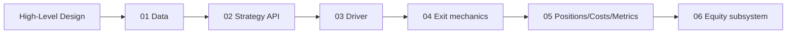

# Engine Architecture — Design Docs

Design documentation for the `buildstrategies` backtesting engine: one
high-level design and six low-level designs, all with mermaid diagrams. These
describe the code under `engine/` (plus how `strategies/` and `analysis/` ride on
it) as it stands today.

For the narrative reference (verdicts, validation history), see
[`../../ENGINE.md`](../../ENGINE.md). These design docs are the structural view.

## Start here

- **[High-Level Design](./high-level-design.md)** — what the system is, the
  central "spot decides when, chain decides at what price" split, the layered
  architecture, end-to-end data flow, the look-ahead guarantee, and the two
  tracks (options + equity).

## Low-level designs

| # | Doc | Modules | Covers |
|---|---|---|---|
| 01 | [Data layer](./lld-01-data-layer.md) | `engine/data/*`, `engine/instruments.py` | `SpotSeries`, `Chain`, `Catalog`/`DataLoader`, `MarketData`, expiry selection, streaming, quarantine, date-keyed lot size |
| 02 | [Strategy API](./lld-02-strategy-api.md) | `engine/strategy/base.py`, `engine/execution/model.py` | `Strategy` hooks, `BarContext` look-ahead truncation, `Order`, `atm_strike`, worked `CPRBreakout` example |
| 03 | [Backtest driver](./lld-03-backtest-driver.md) | `engine/backtest.py` | Per-day loop, fill contract, entry paths, liquidity floor, exit dispatch, partials, intrabar modes, slippage, EOD, `Knobs`, `Result`, legacy `Runner` |
| 04 | [Exit mechanics](./lld-04-exit-mechanics.md) | `engine/strategy/exit.py` | `Exit`, `resolve_level_exit` gap-through, `Bracket`, `TwoStage`, trail math, `spot_level` |
| 05 | [Positions, costs & metrics](./lld-05-position-costs-metrics.md) | `engine/position/manager.py`, `engine/execution/costs.py` | `Position`, `SpreadPosition`, `Trade`, India F&O `CostModel`, `Result` metrics |
| 06 | [Equity subsystem](./lld-06-equity-subsystem.md) | `engine/equity/*` | `EquityBacktest`, day gates, direction-aware slippage, Kite loader, gap router |

## Reading order

Read the HLD first for the mental model, then the LLDs bottom-up (data →
strategy → driver → exits → accounting) or jump straight to the module you're
touching.

## Conventions in these docs

- Diagrams are **mermaid** (render on GitHub and most Markdown viewers).
- Every claim is traceable to a named module / function in `engine/`.
- Rupee figures, validated knob values, and verdicts come from `ENGINE.md` and
  the `analysis/` outputs; treat them as of the last backtest, not live.
