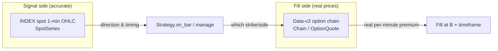
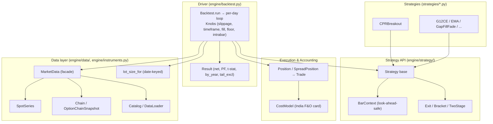
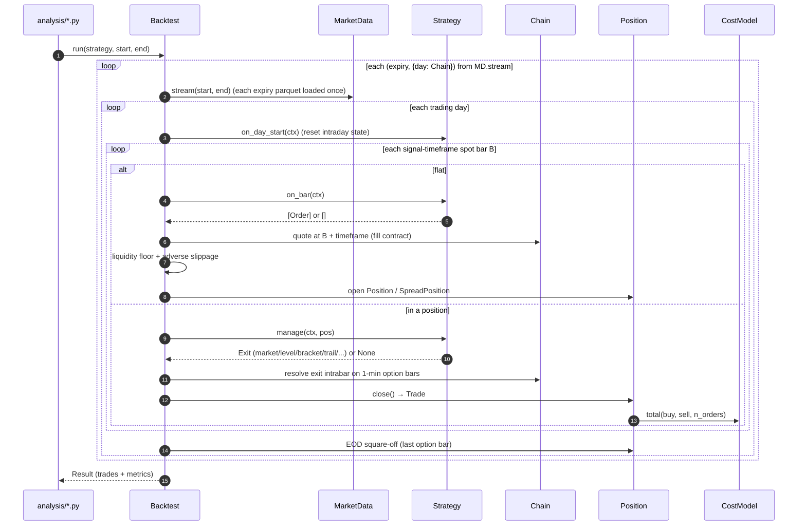
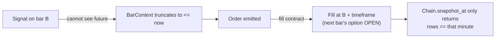
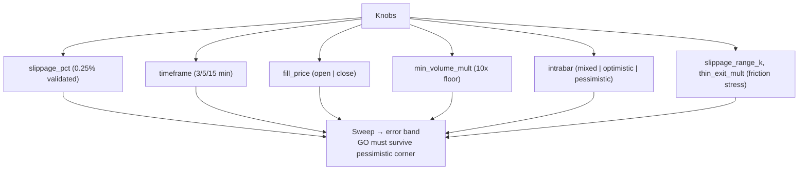
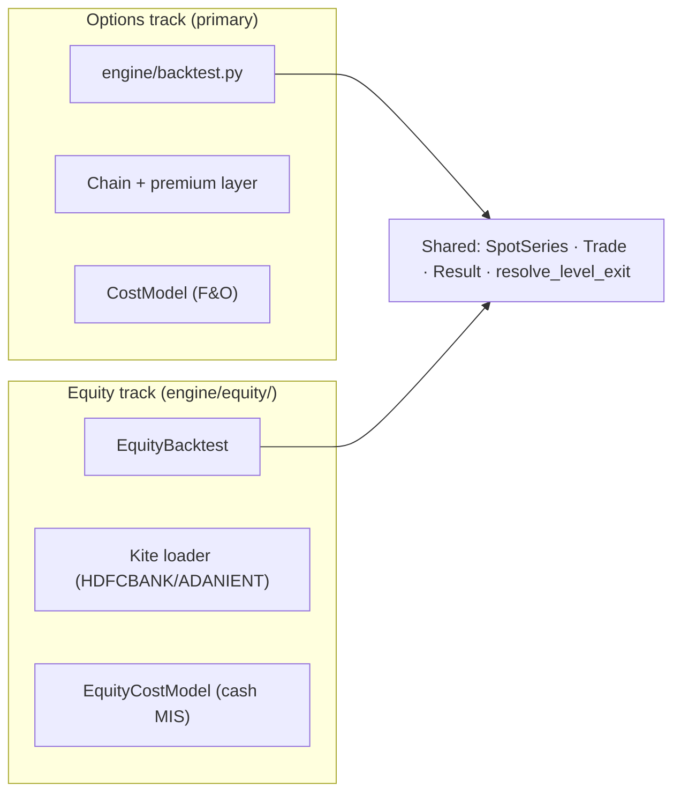

# High-Level Design — NIFTY Options Backtesting Engine

> Scope: the whole engine under `engine/`, plus the strategies (`strategies/`)
> and analysis scripts (`analysis/`) that ride on it.
> Companion low-level docs live in the same folder — see the [index](./README.md).

## 1. What this system is

A from-scratch, **option-buying** backtesting engine for NIFTY (NSE index)
intraday options, covering Jan 2020 – Feb 2026, with a parallel **cash-equity**
track for NSE stocks. It was built test-first (pytest) under one governing rule:

> **Accuracy is the #1 priority — the backtest must be trustworthy, not merely plausible.**

The defining property: it reproduces a known reference strategy (G12-CE)
**582 / 582 trades exact, trade-by-trade**, over 2020–2026 on real data. That is
an identity, not an aggregate-tolerance match, and everything downstream inherits
that trust.

There is exactly **one** way to write a strategy: subclass `Strategy`, receive a
look-ahead-safe `BarContext` each bar, return `Order` / `Exit` objects. A single
`Backtest` driver runs every strategy shape — naked single-leg, multi-leg
credit/debit spreads, partial scale-outs, intrabar premium stops / targets /
trails — through the same proven loop.

## 2. The central design decision

> **Spot decides *when*. The chain decides *at what price*.**

- **Signals fire off the real INDEX spot**, never the option-chain-implied
  `Forward`. Forward's intraday path-noise produces false and missed triggers —
  proven empirically: G12-CE *flipped sign* when signalled off Forward vs. spot.
- **Fills come from the Data-v3 option chain** at the real per-minute price.

The two data sources are never conflated. A strategy reads spot OHLC to decide
direction / timing; the engine prices the actual deep-ITM / ATM / OTM option
from the chain.

## 3. Layered architecture

| Layer | Modules | Responsibility |
|---|---|---|
| **Data** | `engine/data/*`, `engine/instruments.py` | Look-ahead-safe spot & chain, expiry selection, parquet I/O, date-keyed lot size |
| **Execution & accounting** | `engine/position/manager.py`, `engine/execution/costs.py` | Long/spread positions → fully-costed `Trade`; India F&O cost card |
| **Strategy API** | `engine/strategy/*` | `Strategy` hooks, `BarContext`, `Exit`/`Bracket`/`TwoStage` value types |
| **Driver** | `engine/backtest.py` | The per-day loop, fill contract, exit resolution, `Knobs`, `Result` |
| **Strategies** | `strategies/*.py` | Concrete signals; the only bespoke code |
| **Equity track** | `engine/equity/*` | Parallel cash-equity driver, Kite loader, gap router (see LLD-06) |

## 4. End-to-end data flow (one backtest)

## 5. The look-ahead guarantee (why this is trustworthy)

Look-ahead leakage is the #1 way a backtest lies. Two structural defenses,
enforced by construction rather than convention:

1. **`BarContext` truncates to `<= now`** — a strategy is handed the full day but
   the context physically discards future bars, so signal logic *cannot* read
   ahead (see LLD-02).
2. **Fill contract**: a signal on bar `B` fills at **`B + timeframe`**, never at
   `B` itself (see LLD-03).

## 6. The sensitivity reframe (`Knobs`)

A single backtest number is not trustworthy — the same G12 config swung
**+₹135k vs +₹49k** on bar-construction alone. So the engine is *parameterizable*
and the real deliverable is a **sweep**, not one number.

## 7. Two independent tracks

The engine ships two drivers that share only instrument-agnostic pieces
(`SpotSeries`, `Trade`, `Result`, `resolve_level_exit`):

The equity driver **never imports** the options driver — it mirrors its *shape*
but reads the stock's own bars (no chain, no premium). Details in LLD-06.

## 8. Validation posture (what makes it different)

- **Trade-by-trade reconciliation, not tolerance** — G12-CE 582/582 exact.
- **Walk-forward, not in-sample tuning** — the deployable CPR threshold
  (IV ≤ 0.12) was chosen on prior years and validated out-of-sample.
- **Fill audits + liquidity floor** — every entry of the deployable config was
  audited for fillability; the ≥10× floor is wired into the driver.
- **Falsification** — candidate filters were tested *to disprove them* and
  retired when they didn't beat the simple threshold.
- **Test-backed** — 115+ pytest tests across data / execution / position /
  strategy / driver layers, including the golden reconciliation.

## 9. Known limits (acknowledged, not hidden)

- **1-min fidelity cap** — intrabar exits resolve on 1-min option bars;
  sub-minute path is unmodeled, though gap-through logic captures overshoot.
- **No India VIX in the store** — day-open ATM IV is the volatility proxy.
- **NIFTY index has no volume** — VWAP-style strategies use an honest
  equal-weighted proxy; per-strike option volume *is* present (used for the floor).
- **Lot schedule encodes only the 75→65 (2025-12-30) boundary** by default;
  extend `NIFTY_LOT_SCHEDULE` for the full multi-year history.

## 10. Where to go next

| Doc | Covers |
|---|---|
| [LLD-01 Data layer](./lld-01-data-layer.md) | `SpotSeries`, `Chain`, `Catalog`, `MarketData`, `instruments` |
| [LLD-02 Strategy API](./lld-02-strategy-api.md) | `Strategy`, `BarContext`, `Order`, look-ahead truncation |
| [LLD-03 Backtest driver](./lld-03-backtest-driver.md) | Per-day loop, fill contract, exit dispatch, `Knobs`, `Result` |
| [LLD-04 Exit mechanics](./lld-04-exit-mechanics.md) | `Exit`, `Bracket`, `TwoStage`, gap-through, intrabar modes |
| [LLD-05 Positions, costs, metrics](./lld-05-position-costs-metrics.md) | `Position`, `SpreadPosition`, `Trade`, `CostModel`, `Result` |
| [LLD-06 Equity subsystem](./lld-06-equity-subsystem.md) | `EquityBacktest`, Kite loader, gap router |
