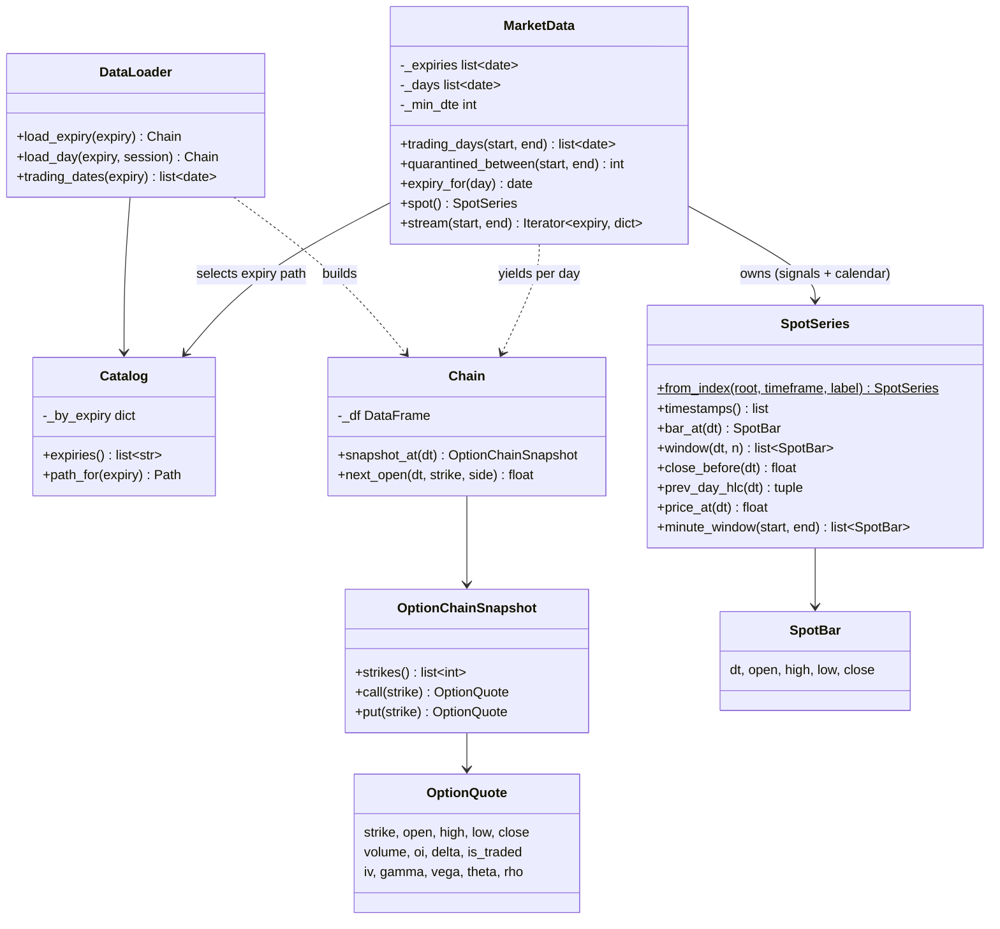
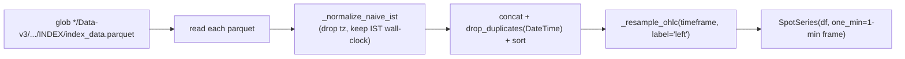
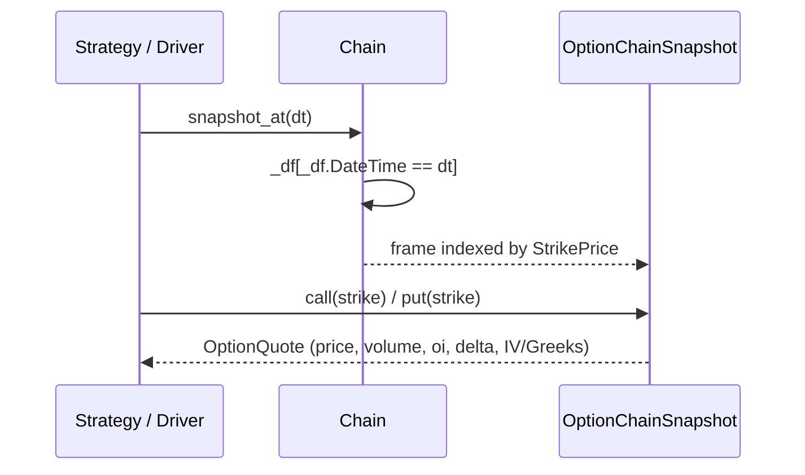
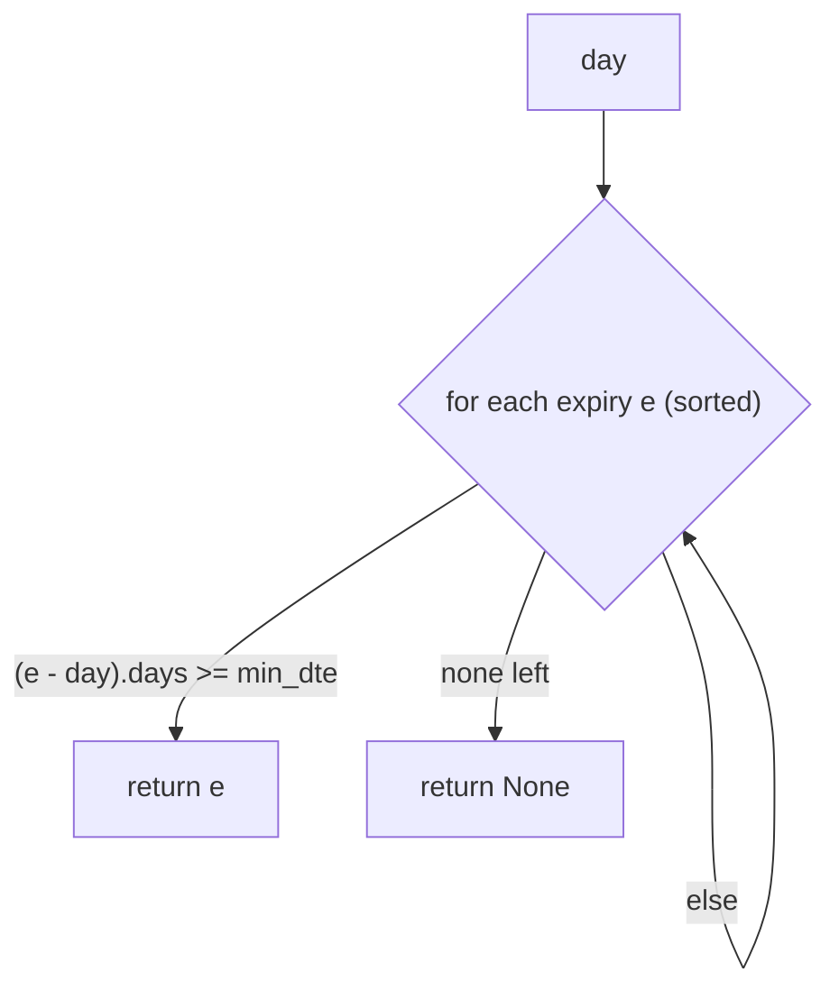
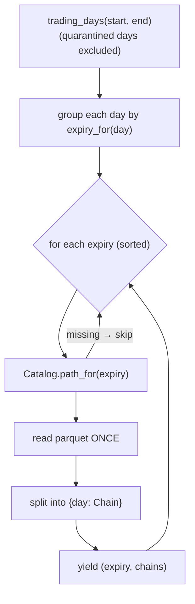

# LLD-01 — Data Layer

> Modules: `engine/data/spot.py`, `engine/data/chain.py`, `engine/data/catalog.py`,
> `engine/data/loader.py`, `engine/data/market.py`, `engine/instruments.py`.
> Parent: [High-Level Design](./high-level-design.md).

The data layer is the foundation of the engine's trust. It does two jobs and
keeps them strictly separate: serve **spot OHLC for signals** and serve
**option-chain quotes for fills**, both point-in-time so no caller can reach a
future bar.

## 1. Component map



## 2. Two data sources, deliberately separate

| Source | File pattern | Feeds |
|---|---|---|
| **INDEX spot** (1-min OHLC, 2019-12 → 2026-02) | `.../INDEX/index_data.parquet` | signals + the trading-day calendar |
| **Data-v3 option chain** (~328 weekly expiries, 2020-01 → 2026-03) | per-expiry `options_data.parquet` | fills + IV/Greeks + liquidity |

The store is scattered across many `Data N` folders under
`ROOT = /Users/gokul/Desktop/tradealgo/data nifty `. The loaders glob and dedupe
them — no consolidation step is required.

## 3. `SpotSeries` — look-ahead-safe spot for signals

`SpotSeries` wraps a spot bar frame and only ever returns data **as of** a
requested minute. Signal logic physically cannot see future bars through it.

### Construction pipeline (`from_index`)



Key construction decisions:

- **START-labeled bars** (`label='left'`, `closed='left'`): a bar labelled `B`
  covers `[B, B+timeframe)`. This is the canonical convention and it is what
  makes the `B + timeframe` fill contract exact (LLD-03).
- **Naive IST throughout.** Mixed tz-aware / naive timestamps silently misalign,
  so everything is coerced to IST wall-clock with tz dropped.
- **Retained 1-min frame** (`_df1m`): the pre-resample minutes are kept so
  intrabar spot-level exits (`minute_window`) resolve on true minutes even when
  the signal timeframe is 5-min.

### Accessors and their guarantees

| Method | Returns | Look-ahead property |
|---|---|---|
| `timestamps()` | all bar timestamps in order | the runner's minute axis |
| `bar_at(dt)` | O(1) `SpotBar` at exactly `dt` | via `_pos` position index |
| `window(dt, n)` | up-to-`n` bars *ending* at `dt` | for rolling ATR/ROC, no forward peek |
| `close_before(dt)` | prev-session close (gap gates) | O(log n) `searchsorted` before midnight |
| `prev_day_hlc(dt)` | prior session `(H, L, C)` — CPR inputs | filters `DateTime < day_start` |
| `price_at(dt)` | close of bar at-or-before `dt` | `<= dt` filter |
| `minute_window(start, end)` | 1-min bars in `[start, end)` | intrabar exit resolution |

The O(1) `bar_at` (dict `_pos: {timestamp -> row index}`) matters because it is
the per-bar hot path; scanning the frame each minute would be O(n) per bar.

## 4. `Chain` + `OptionChainSnapshot` — point-in-time option quotes

A `Chain` wraps a per-minute long-format DataFrame (one row per
`(DateTime, StrikePrice)`, with `Call*` and `Put*` columns) and exposes data
only as of a requested minute.



- `snapshot_at(dt)` filters to the exact minute (`DateTime == dt`) — the caller
  cannot reach past that minute.
- `next_open(dt, strike, side)` returns the open of the **first minute strictly
  after `dt`** — the only sanctioned fill-price source in the legacy execution
  path; fills never occur at `dt` itself.
- `OptionQuote` carries price, `volume`, `oi`, `delta`, `is_traded`, and
  **optional** IV / Gamma / Vega / Theta / Rho. Greeks are pass-through: `None`
  when the source column is absent or NaN — no Black-Scholes recompute. IV /
  Gamma / Vega are chain-level; Theta / Rho are per-leg (`CallTheta`, `PutTheta`).

`is_traded` (`CallIsTradedStrike` / `PutIsTradedStrike`) is the tradeability
flag: a non-traded strike must not be filled, and its volume is treated as 0 for
the liquidity floor.

## 5. `Catalog` + `DataLoader` — parquet discovery and reading

`Catalog` walks the Hive-style partitions once and maps `expiry -> parquet path`,
de-duplicating expiries that appear in more than one `Data N` folder (first found
wins):

```
<Data N>/Data-v3/instrument=NIFTY50/OPTIONS/expiry=YYYY-MM-DD/options_data.parquet
```

`DataLoader` is the only component that reads an option parquet directly. It can
load a whole expiry (`load_expiry`) or a single session (`load_day`), returning a
`Chain`. In the primary backtest path, `MarketData.stream` does the reading
instead (batched per expiry); `DataLoader` backs the legacy `Runner` and tests.

## 6. `MarketData` — the unified facade

`MarketData` knows all the data: the resident `SpotSeries` (signals + calendar)
and the `Catalog` (fills). It makes two accuracy-critical decisions.

### 6.1 Expiry selection from real partitions



`expiry_for(day)` returns the nearest expiry on/after `day` with at least
`min_dte` days to expiry. This is done from the **real** expiry partitions, never
a weekday rule — the expiry weekday changed Thu→Tue around Sep 2025, so any
weekday heuristic would be wrong across that boundary. `min_dte` is configurable
(the G12 reconciliation hinged on getting it right — a mismatch caused the
initial 56/124 miss).

### 6.2 Streaming — each expiry parquet loaded exactly once



`stream()` groups days by their chosen expiry, then loads each expiry parquet a
single time and slices it into per-day `Chain` objects. This is the ARCH-4
one-load-per-expiry guarantee — the driver never re-reads a parquet.

### 6.3 Data integrity gate (quarantine)

`trading_days()` excludes quarantined days (written by
`analysis/data_integrity.py` and loaded via `load_quarantine`). A bad-data day
can never become a trade. The count is still reported via
`quarantined_between()` so the exclusion is visible, not silent.

## 7. `instruments.lot_size_for` — date-keyed lot size

NIFTY lot size is not constant: **75 → 65 effective 2025-12-30**. A backtest that
hardcodes one value is wrong across that boundary, so the engine (not the
strategy) owns it.

```python
NIFTY_LOT_SCHEDULE = [(date(1900,1,1), 75), (date(2025,12,30), 65)]
lot_size_for(d)  # latest schedule entry with effective_date <= d
```

The driver calls `lot_size_for(day)` when converting a strategy's `lots` into a
share `qty`. The default schedule encodes only the one validated boundary; pass a
custom schedule to extend the full multi-year history.

## 8. Design rationale summary

| Decision | Why | Alternative rejected |
|---|---|---|
| Spot for signals, chain for fills | Forward path-noise flips signals | Signalling off Forward (G12 flipped sign) |
| START-labeled bars | Makes `B + timeframe` exact | END-labeled (off-by-one fills) |
| Naive IST everywhere | tz mix silently misaligns | Mixed tz-aware/naive |
| Expiry from real partitions | Weekday changed Thu→Tue | Weekday rule |
| One parquet load per expiry | Perf on 6-year backtests | Per-day reads |
| Quarantine excluded but counted | Bad data ≠ trade, but stays visible | Silent drop |
| Date-keyed lot size in engine | 75→65 boundary correctness | Strategy-supplied constant |
