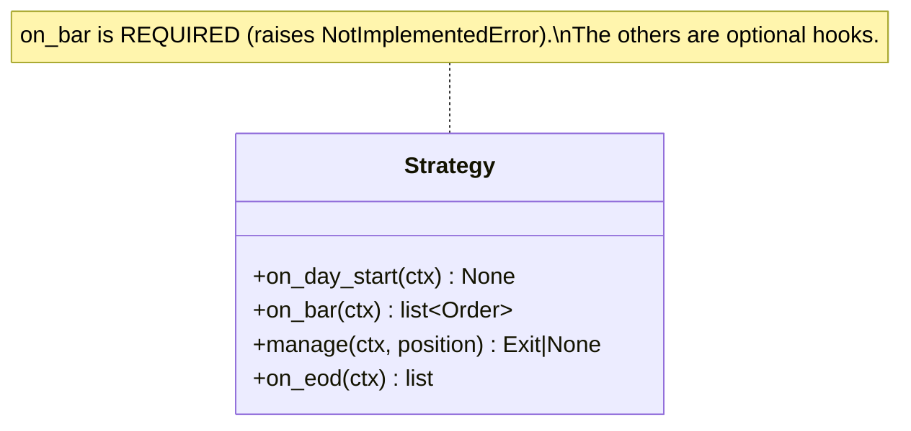
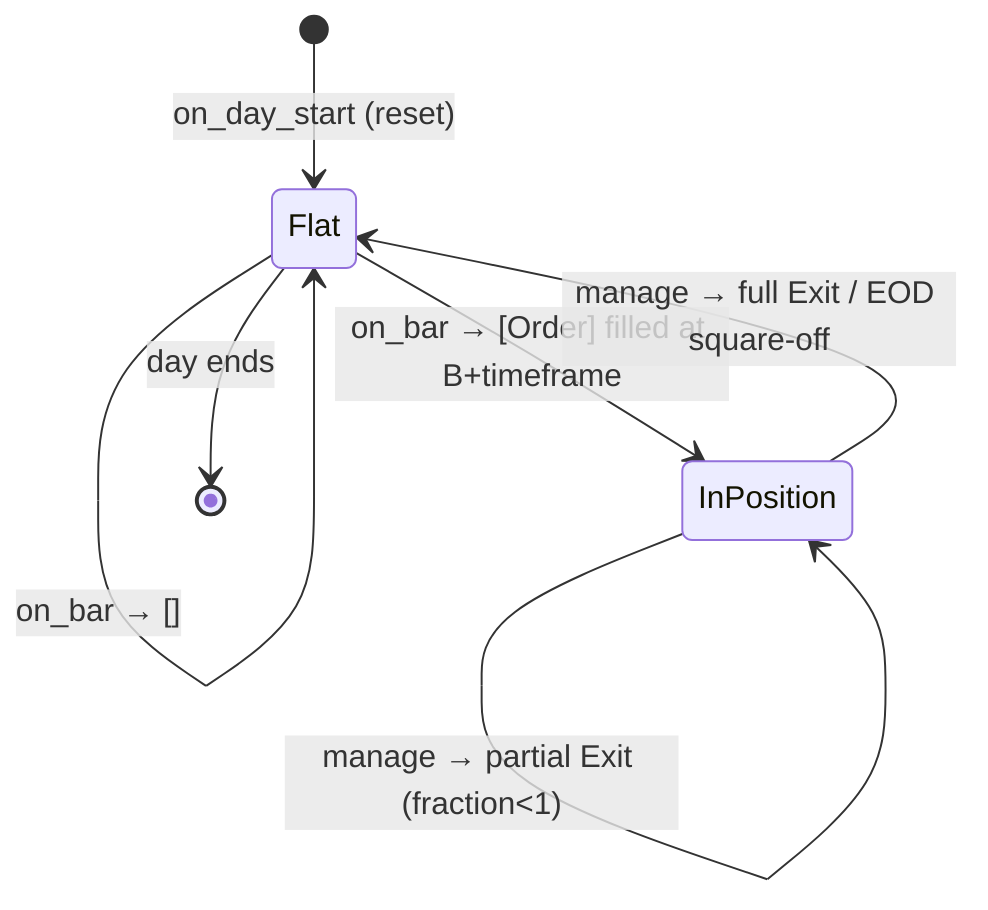
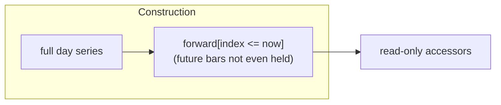
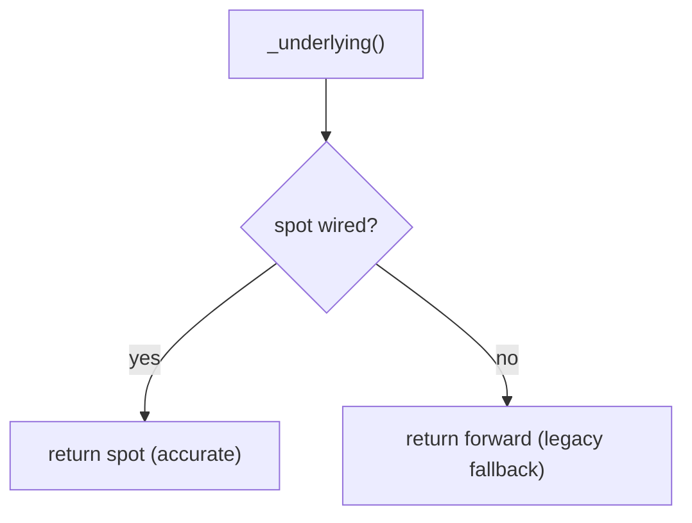
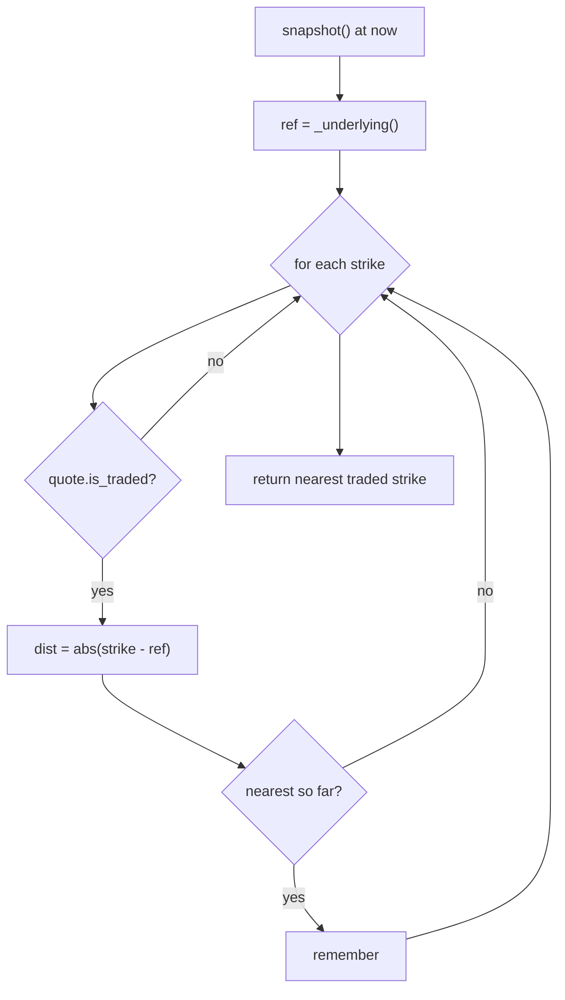
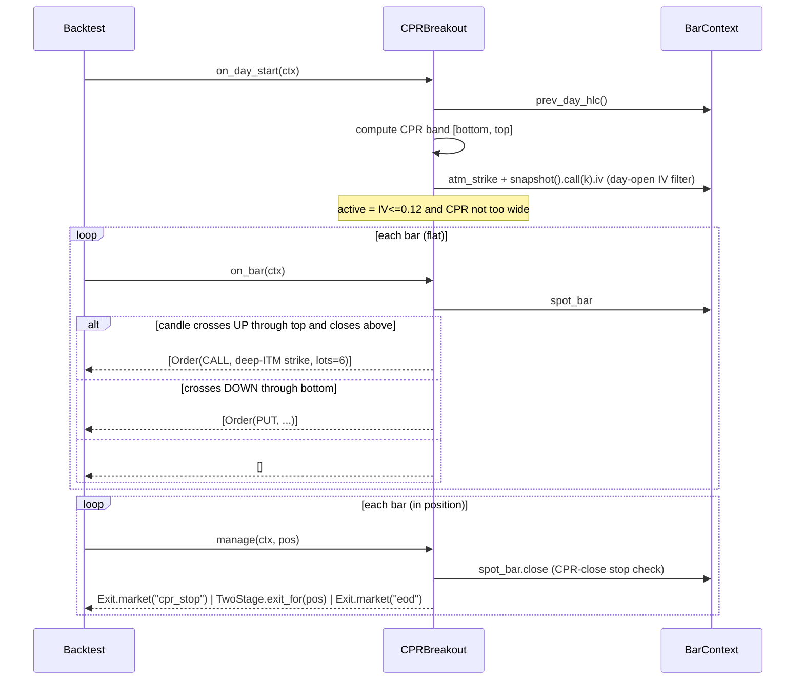

# LLD-02 — Strategy API

> Modules: `engine/strategy/base.py`, `engine/execution/model.py` (the `Order`
> value type). Exit types are covered in [LLD-04](./lld-04-exit-mechanics.md).
> Parent: [High-Level Design](./high-level-design.md).

A strategy is the only bespoke code in the system. Everything else is shared,
proven machinery. This doc specifies the contract a strategy must satisfy and the
`BarContext` — the sole window a strategy has onto the market.

## 1. The `Strategy` contract



| Hook | When | Contract |
|---|---|---|
| `on_day_start(ctx)` | first bar of each day | reset intraday state — the engine is intraday-only, nothing carries overnight |
| `on_bar(ctx)` | every signal-timeframe bar **while flat** | **required**; return `[Order]` to enter, or `[]` to stay flat |
| `manage(ctx, position)` | every bar **while in a position** | return an `Exit` (or `None` to hold) |
| `on_eod(ctx)` | end of day | optional; default `[]` |

The driver only calls `on_bar` when flat and `manage` when in a position — a
strategy never has to track that state machine itself.



## 2. `Order` — a strategy's intent

From `engine/execution/model.py`:

```python
@dataclass(frozen=True)
class Order:
    side: str            # "CALL" or "PUT"
    strike: int
    qty: Optional[int] = None   # explicit share count (legacy)
    lots: int = 1               # size in lots; engine → qty via lot_size_for(day)
    action: str = "buy"         # "buy" (long premium) or "sell" (short leg of a spread)
```

- **Size in `lots`.** The engine converts to a share `qty` via the date-keyed
  `lot_size_for(day)` (LLD-01 §7) — the strategy never hardcodes 75 or 65.
  `qty` may be set directly for legacy / explicit sizing.
- **`action`** enables spreads: returning multiple orders, or any order with
  `action="sell"`, routes the entry through `SpreadPosition` (LLD-03 §4, LLD-05).
- Long-premium single leg is the default and the common case.

## 3. `BarContext` — the only view of the world

`BarContext` is constructed with the full day's forward series but **immediately
truncates to `<= now`**, so a strategy physically cannot read future bars.



The truncation is the structural half of the look-ahead guarantee (the other
half is the fill contract, LLD-03). Even a buggy strategy that tries to peek
ahead has nothing to peek at.

### 3.1 Surface

| Member | Returns | Purpose |
|---|---|---|
| `now` | `datetime` | current bar timestamp |
| `spot` | `float` | close of the as-of-now spot bar |
| `spot_bar` | `SpotBar` | current spot OHLC |
| `spot_history()` | `list[SpotBar]` | all bars `<= now` |
| `recent(n)` | `list[SpotBar]` | up-to-`n` bars ending at now (rolling indicators) |
| `prev_close()` | `float` | prior session close (gap gates) |
| `prev_day_hlc()` | `(H, L, C)` | prior session — CPR inputs |
| `snapshot()` | `OptionChainSnapshot` | as-of-now option chain |
| `atm_strike(side)` | `int` | nearest **traded** strike to the underlying |
| `opening_range(end_time)` | `(high, low)` | forward range from open to `end_time` (legacy forward path) |
| `forward` | `float` | legacy option-implied underlying (fallback only) |

### 3.2 Spot vs. forward underlying



`_underlying()` returns spot when a `SpotSeries` is wired (the standard path) and
falls back to the option-implied `forward` only for legacy reconciliation runs.
New strategies always run on spot.

### 3.3 Strike selection — `atm_strike`



`atm_strike` honours tradeability — it skips non-traded strikes entirely, so a
strategy never selects a strike it could not actually fill. Strategies that want
deep-ITM or OTM strikes (e.g. `cpr_breakout`) compute an offset off the spot
themselves and let the chain price it.

## 4. Worked example — `CPRBreakout`

`strategies/cpr_breakout.py` exercises the full contract:



Notable patterns a strategy author reuses:

- **Intraday state** (`self.top`, `self.entered`, `self.side`) is set in
  `on_day_start` / `on_bar` and reset every day.
- **Filters gate `active`** — a day the IV or CPR-width filter rejects simply
  never emits an order.
- **Exit policy is delegated** to a `TwoStage` object (LLD-04 §3) that owns the
  scale-out-then-trail handoff, so `manage` stays a few lines.

## 5. Look-ahead safety checklist for authors

- Read only from `ctx` — never touch `SpotSeries` / `Chain` directly.
- Decide direction and timing off **spot**; let the engine price the option.
- Return `lots`, not a hardcoded share count.
- Put all per-day resets in `on_day_start`.
- Never assume you know the fill price — you get `B`, the engine fills at
  `B + timeframe` (LLD-03).
