# LLD-03 — Backtest Driver (Options)

> Module: `engine/backtest.py` (`Backtest`, `Knobs`, `Result`).
> Exit value types → [LLD-04](./lld-04-exit-mechanics.md); positions & costs →
> [LLD-05](./lld-05-position-costs-metrics.md).
> Parent: [High-Level Design](./high-level-design.md).

The driver is the single loop that runs every strategy shape — naked leg, spread,
scale-out, intrabar stop / target / trail — through the same proven path. This is
where the fill contract, liquidity floor, slippage, and exit resolution live.

## 1. Top-level flow

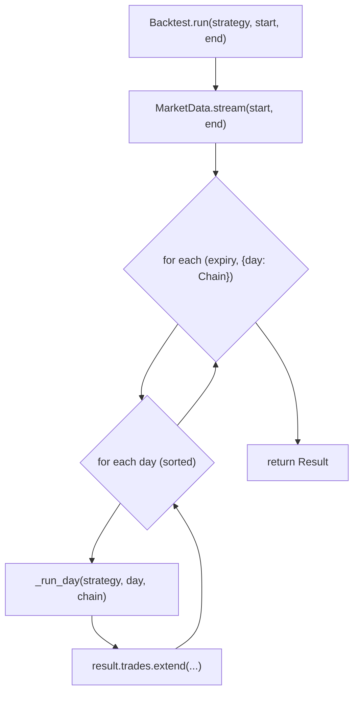

`run` is thin: it drives `MarketData.stream` (one parquet load per expiry) and
delegates each day to `_run_day`. All the mechanics are in `_run_day`.

## 2. `_run_day` — the per-day state machine

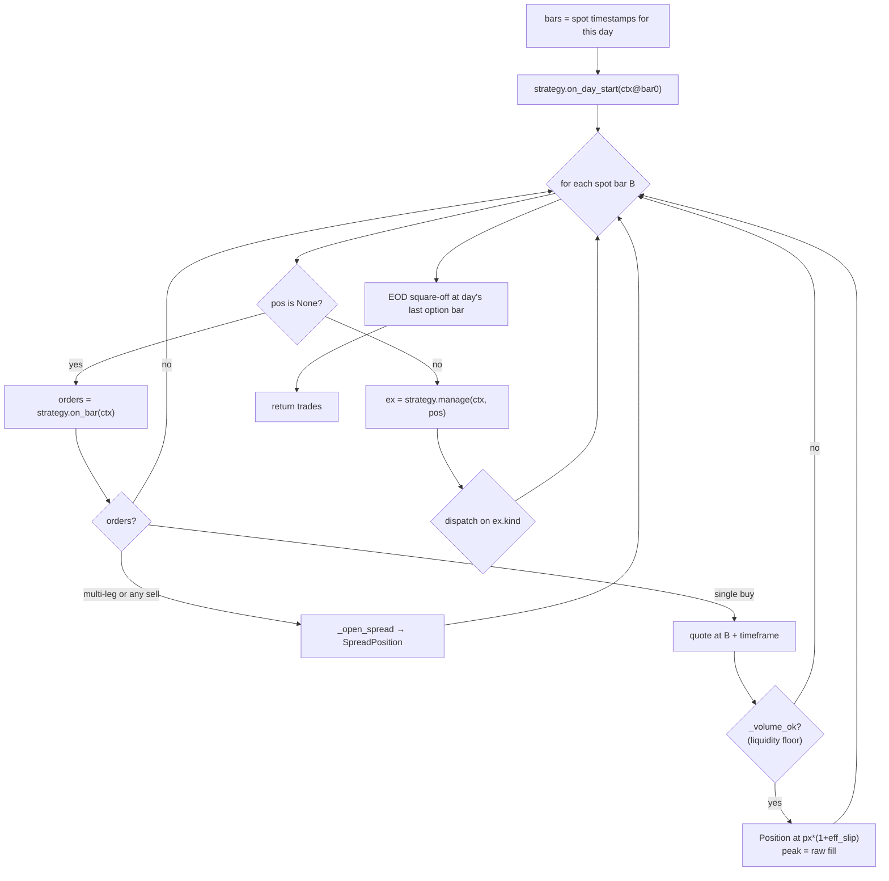

Single position at a time. After a full exit the loop keeps scanning, so a
strategy may trade more than once a day.

## 3. The fill contract (anti-look-ahead)

> A signal on bar `B` fills at **`B + timeframe`** — the next bar's option open by
> default. Enforced structurally, not by convention.

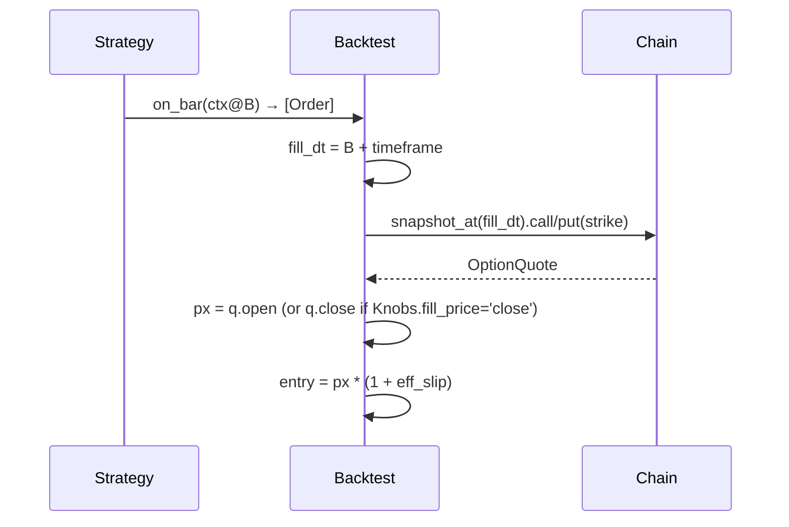

`Knobs.fill_price` selects which price at `fill_dt`:

- `'open'` — the principled next-open (default).
- `'close'` — matches the legacy G12 scripts' convention, used only for
  reconciliation.

If the quote at `fill_dt` is missing, no position opens (the signal is dropped
that bar).

## 4. Entry paths

### 4.1 Single leg

`orders[0]` with `action="buy"` and one leg:

1. `q = _opt_quote(chain, fill_dt, strike, side)` — `None` → skip.
2. `qty = orders[0].qty or lots * lot_size_for(day)`.
3. Liquidity floor: `_volume_ok(...)` — signal-bar option volume must be
   `>= min_volume_mult * qty`, else skip (no re-entry; the strategy already
   marked the day entered).
4. `Position(side, strike, px*(1+eff_slip), qty)`; `peak = px` (raw fill seeds
   the trail peak).

### 4.2 Spread (multi-leg or any sell)

Routed to `_open_spread` when `len(orders) > 1` **or** any `action == "sell"`:

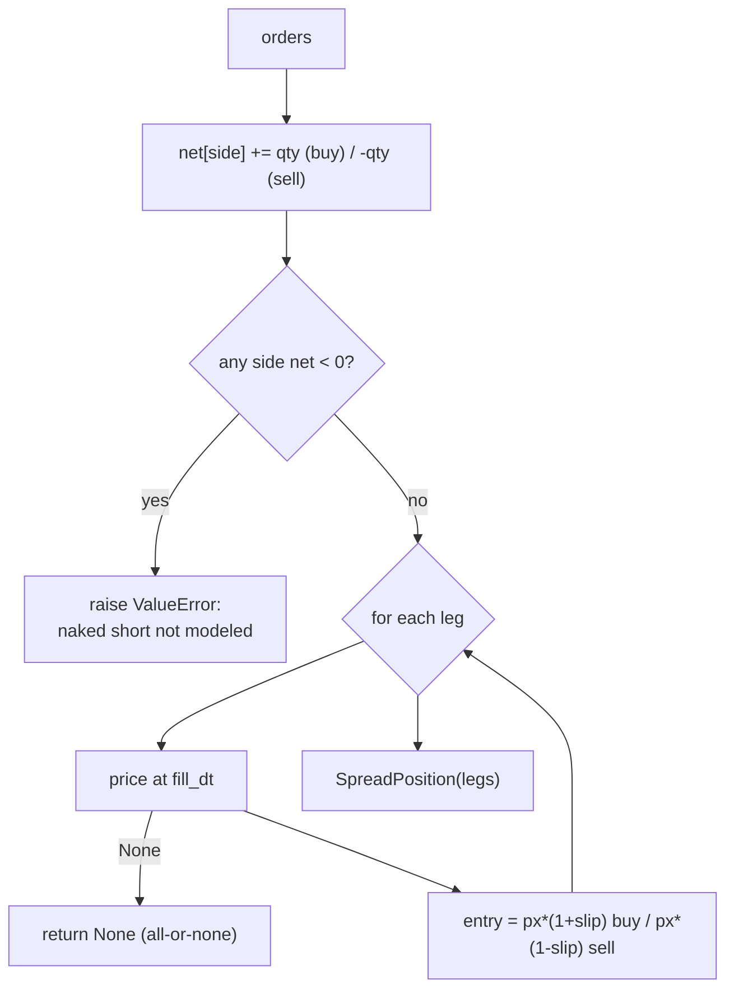

**Naked-short guard.** Per option side, sold qty must not exceed bought qty.
Covered verticals are fine; NET-short exposure (unbounded loss, margin,
assignment) is refused loudly instead of being priced wrong. Spread fills are
all-or-none: if any leg can't be priced the whole entry aborts.

## 5. Liquidity floor — `_volume_ok`

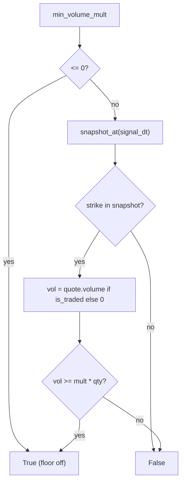

The floor is judged on **signal-minute** volume (mirrors the validated fill
audit). Not-traded or missing strike → volume 0 → reject. The validated floor is
**10×**: it removes net-losing thin trades rather than hurting the edge.
`mult <= 0` disables it.

## 6. Exit dispatch — `manage` result kinds

While in a single-leg position, `manage(ctx, pos)` returns an `Exit` and the
driver dispatches on `ex.kind`:

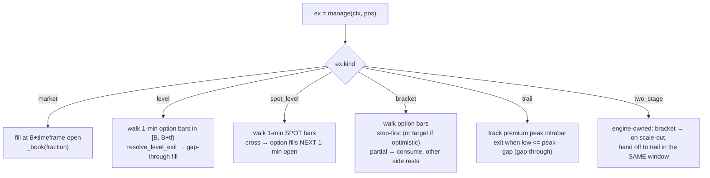

Each kind and its intrabar math is specified in [LLD-04](./lld-04-exit-mechanics.md).
Two mechanics worth stating at the driver level:

- **Level / bracket / trail / two_stage** resolve against the option's **1-min
  high/low** via `_opt_window(chain, B, B+timeframe, ...)` — so overshoot that a
  close-only sampler would miss is modeled.
- **`spot_level`** resolves the crossing on 1-min **spot** bars, then fills the
  option at the **next 1-min open** — one minute of honest latency.

Spread positions accept only `Exit.market` (fill each leg at `B+timeframe`,
all-or-none) — resting/intrabar exits are single-leg only.

## 7. Partial scale-outs — `_book`

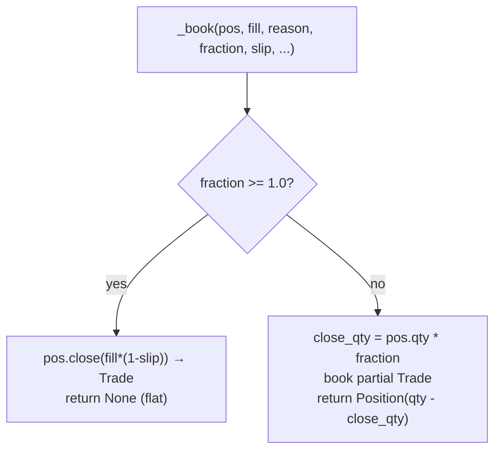

`fraction < 1.0` books a partial and returns the remaining `Position` to ride —
partial scale-out is a first-class engine feature. `two_stage` and a partial
`bracket` both loop `_book` within one window: after a partial fill the other
side keeps resting via `ex.consume(reason)`.

## 8. Intrabar ambiguity — the `intrabar` knob

Inside a single 1-min bar the true order of events is unknowable. `Knobs.intrabar`
bounds it, and a GO verdict should survive the pessimistic corner:

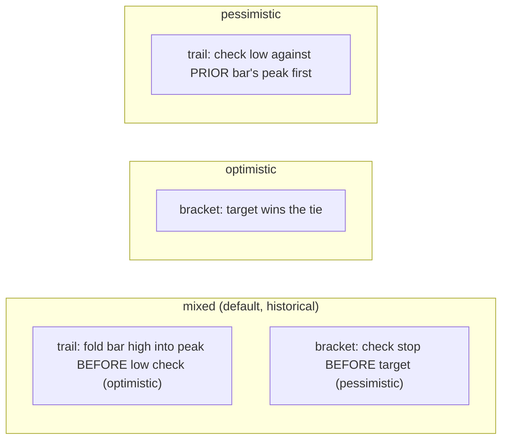

| Kind | `mixed` | `optimistic` | `pessimistic` |
|---|---|---|---|
| `bracket` | stop-first | target wins tie | stop-first |
| `trail` | high→peak then low check | same as mixed | low checked vs prior peak first |

Run both extremes; read the spread as the error band. The driver validates
`intrabar ∈ {mixed, optimistic, pessimistic}` at construction.

## 9. Effective slippage — `_eff_slip`

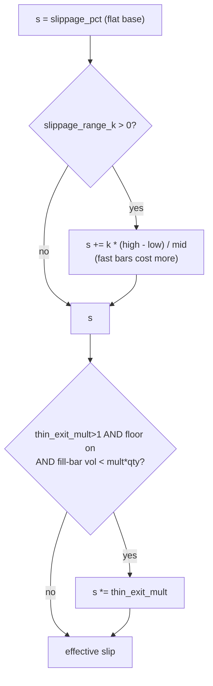

Slippage is applied adversely to the **fill price** (not in the cost model):
`fill * (1 + slip)` on a buy, `fill * (1 - slip)` on a sell. The validated
realistic value is **0.25%** (justified by a liquidity audit — a 6-lot order is
~0.01% of the deep-ITM strike's median day-volume, so market impact ≈ 0). The two
extras (`slippage_range_k`, `thin_exit_mult`) default off, reproducing the flat
historical behavior.

## 10. EOD square-off

The engine is strictly intraday — nothing holds overnight.

```mermaid
flowchart TB
    A["day loop ends with pos open"] --> B{"SpreadPosition?"}
    B -->|yes| S["price each leg at day's last option bar<br/>close all-or-none, reason='eod'"]
    B -->|no| L["quote at day's last option bar<br/>close at q.close*(1-eff_slip), reason='eod'"]
```

## 11. `Knobs` — the sensitivity dials

```python
Knobs(slippage_pct=0.0, timeframe="5min", fill_price="open",
      min_volume_mult=0.0, intrabar="mixed",
      slippage_range_k=0.0, thin_exit_mult=1.0)
```

| Knob | Meaning | Validated / default |
|---|---|---|
| `slippage_pct` | flat adverse slip on every fill | 0.25% realistic |
| `timeframe` | signal-bar size (also the fill offset) | `"5min"` |
| `fill_price` | `'open'` (principled) or `'close'` (G12 legacy) | `'open'` |
| `min_volume_mult` | liquidity floor multiple; 0 = off | 10× validated |
| `intrabar` | `mixed` / `optimistic` / `pessimistic` | `mixed` |
| `slippage_range_k` | range-scaled friction; 0 = off | 0 |
| `thin_exit_mult` | penalty when exit bar can't absorb qty; 1 = off | 1 |

## 12. `Result` — metrics

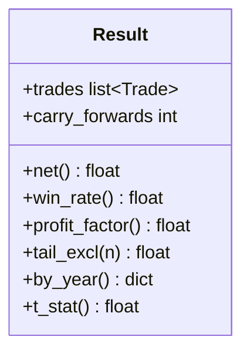

| Metric | Definition | Reads as |
|---|---|---|
| `net()` | Σ `t.net` | rupee P&L |
| `win_rate()` | share of trades with `net > 0` | hit rate |
| `profit_factor()` | Σ wins / Σ losses | > 1 = profitable; `inf` if no losses |
| `tail_excl(n)` | net with the top-`n` winners removed | tail-dependence check |
| `by_year()` | `{year: net}` | is every year green? |
| `t_stat()` | t-stat of mean per-trade return on premium deployed | significance |
| `carry_forwards` | option-price gaps carried forward | data-quality counter |

`t_stat` normalizes each trade's P&L by capital deployed (`entry * qty`) so it
measures return significance, not rupee size. Needs ≥ 2 trades.

## 13. Appendix — the legacy `Runner`

`engine/runner.py` + `engine/execution/model.py` + `engine/position/exits.py` are
an **earlier, simpler** path that predates the `Backtest` driver:

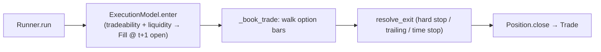

It supports one exit family (percentage hard-stop + trailing + time stop via
`resolve_exit`) and keeps `Rejection` records so orders are never silently
dropped. It is retained for the `test_runner_*` golden tests and simple studies;
new work uses `Backtest`, which subsumes it with richer exits, spreads, partials,
and the `Knobs` sweep. Both share `Position`, `CostModel`, and the fill-at-next
principle.
