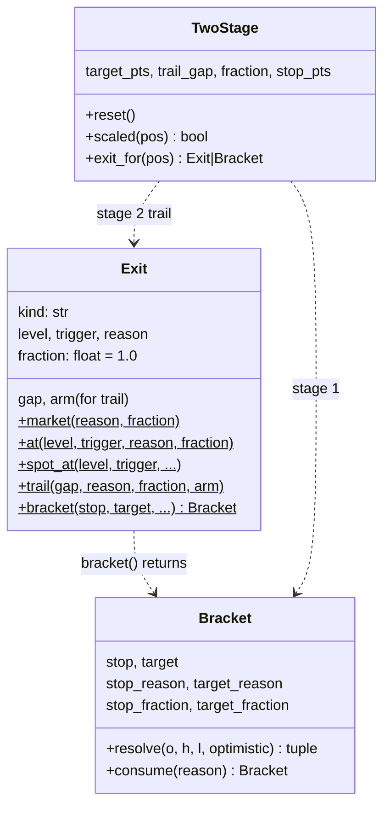
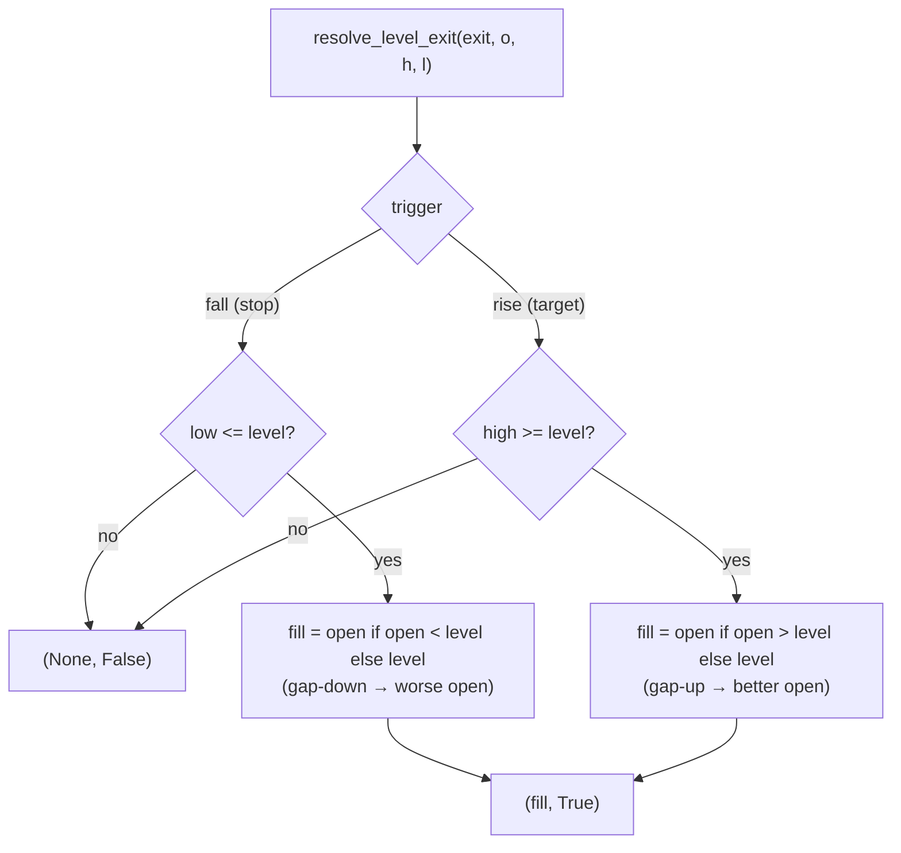
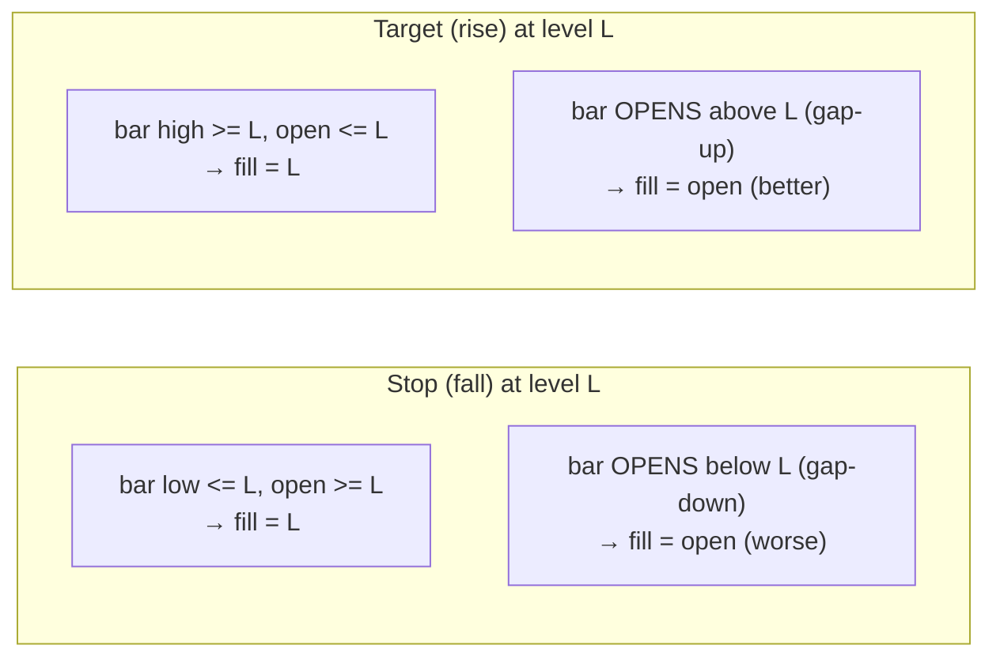
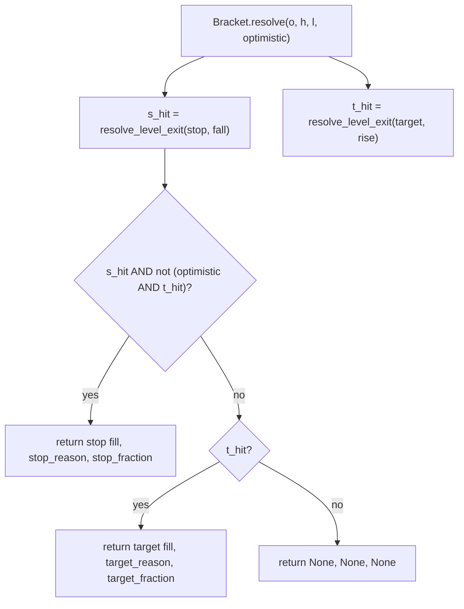
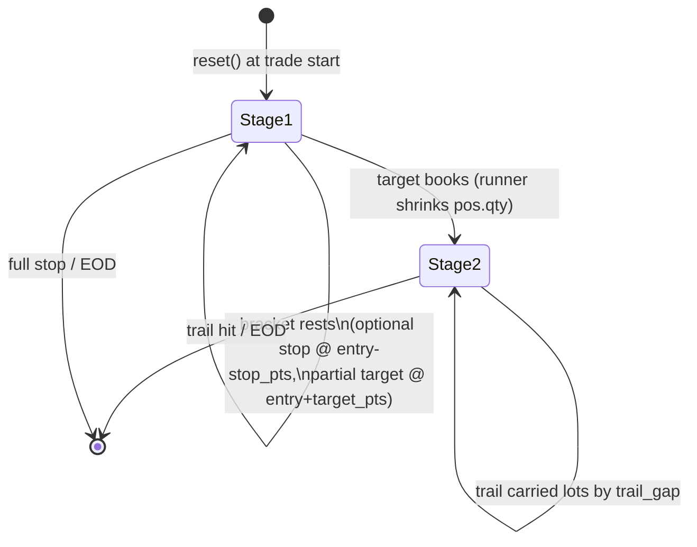
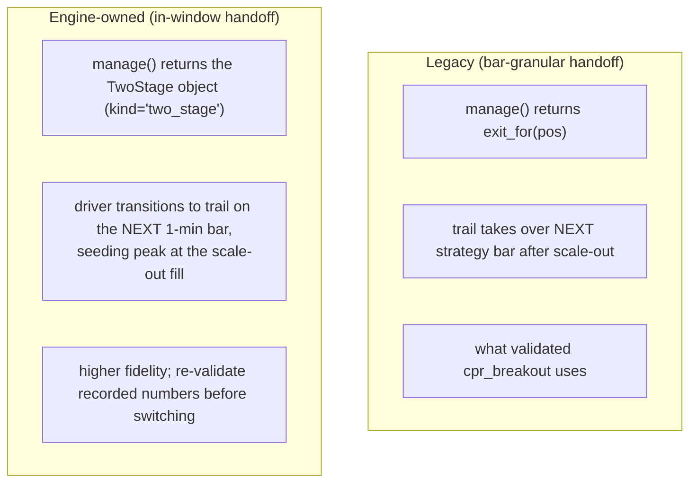
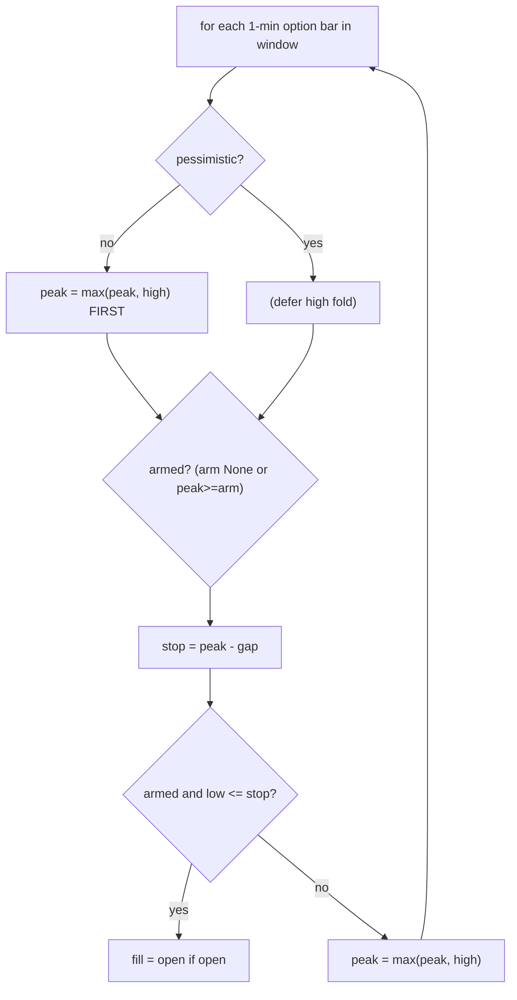

# LLD-04 — Exit Mechanics

> Module: `engine/strategy/exit.py` (`Exit`, `Bracket`, `TwoStage`,
> `resolve_level_exit`). Driver dispatch → [LLD-03](./lld-03-backtest-driver.md).
> Parent: [High-Level Design](./high-level-design.md).

Exits are the accuracy-critical half of a backtest — where "did it really fill
there?" is answered. This module is pure price logic: it returns a fill price and
a reason; slippage and costs are applied downstream by the driver.

## 1. The `Exit` value type

`manage()` returns one `Exit` (or `None` to hold). `Exit` is a frozen dataclass
with factory constructors:

| Constructor | `kind` | Meaning |
|---|---|---|
| `Exit.market(reason, fraction)` | `market` | discretionary → next-open fill |
| `Exit.at(level, trigger, ...)` | `level` | resting stop (`'fall'`) / target (`'rise'`), intrabar, gap-through |
| `Exit.spot_at(level, trigger, ...)` | `spot_level` | resting exit keyed on **spot**; option fills next 1-min open |
| `Exit.trail(gap, ..., arm)` | `trail` | premium trailing stop off the intrabar peak |
| `Exit.bracket(stop, target, ...)` | `bracket` | premium stop **and** target together |

`fraction < 1.0` books a partial and rides the rest. `trigger` must be `'fall'`
(stop) or `'rise'` (target); the constructors validate it.

## 2. `resolve_level_exit` — the gap-through primitive

Every intrabar level check goes through this one function. It resolves a level
`Exit` against a single option bar `(open, high, low)`:

**Gap-through honesty.** If the bar *opened* already past the level, the fill is
the bar OPEN — worse for a stop (gap-down), better for a target (gap-up) — the
realistic fill of a resting order on a gap. Otherwise the fill is the level
itself. A close-only sampler would miss this overshoot; the engine models it.
1-min granularity caps fidelity, and that cap is acknowledged.

## 3. `Bracket` — stop and target together

A `Bracket` rests a premium stop and a premium target on the same option bars
(e.g. P&L ±X). `resolve` checks one bar and returns `(fill, reason, fraction)` or
`(None, None, None)`:

When both sides are inside one bar the true order is unknowable at 1-min
resolution:

- default (**pessimistic / conservative**): the **stop** wins the tie.
- `optimistic=True` (from `Knobs.intrabar='optimistic'`): the **target** wins.

Running both orderings brackets the truth. Per-side fractions allow, e.g., a
full-size stop but a partial scale-out at target.

### `consume` — partial fills keep the other side resting

After a PARTIAL fill of one side, the other side must keep resting for the rest of
the window. `consume(reason)` returns a `Bracket` with the filled side moved out
of reach (`target = +inf` or `stop = -inf`), matched by its reason string — which
is why the two sides need distinct reasons.

## 4. `TwoStage` — scale-out then trail

`TwoStage` is the engine-owned policy shared by scale-out strategies
(`cpr_breakout`, `ema5_itm`): stage 1 rests an optional full-size premium stop
bracketed with a partial target; once the target books, stage 2 trails the
carried lots.

Stage detection is **qty-based**: `scaled(pos)` records the full size on first
call and returns `True` once `pos.qty` shrinks below it (the driver's `_book`
shrank it on the partial). Two usage modes:

- **Legacy mode** — `manage` returns `exit_for(pos)`, which yields a `Bracket`
  while flat-of-scale and an `Exit.trail` after. The handoff happens on the next
  *strategy* bar. `cpr_breakout` uses this (its recorded numbers depend on it).
- **Engine-owned mode** — `manage` returns the `TwoStage` object itself; the
  driver's `two_stage` branch does the scale→trail handoff inside the same 1-min
  window, seeding the trail peak at the scale-out fill. Higher fidelity, but
  re-validate before switching a strategy over.

`NO_STOP = -inf` gives an unreachable stop when no loss-cap is set.

## 5. Trail mechanics (driver side)

`Exit.trail(gap, arm)` exits when the premium falls `gap` points below its
running intrabar peak. The peak is tracked by the driver from entry; `arm` keeps
the trail dormant until the peak first reaches an absolute premium level (bar
highs still feed the peak while dormant).

The `mixed`/`optimistic` path folds this bar's high into the peak before checking
its low (optimistic); `pessimistic` checks the low against the prior bar's peak
first, then folds. Same gap-through worse-open rule as level exits.

## 6. `spot_level` — exit on spot, fill on option

`Exit.spot_at(level, trigger)` is a resting exit keyed on the **spot** level,
resolved on 1-min spot bars. The first minute whose range crosses `level`
recognizes the exit, and the option fills at the **next 1-min open** — one minute
of honest latency. This replaces the older bar-latency `Exit.market('spot_sl')`
pattern with a cleaner resting-order model. Return it from `manage()` every bar
like any other resting exit. Direction is the direction of **spot** regardless of
option side (`'fall'` fires when spot drops to level, `'rise'` when it climbs).

## 7. Reason strings

Every close carries a reason string that flows into `Trade.reason`, so a results
frame can be sliced by exit cause (`cpr_stop`, `book`, `ptrail`, `pstop`, `eod`,
`target`, `stop`, ...). `Bracket.consume` and `TwoStage` rely on these being
distinct per side.

## 8. Design rationale

| Decision | Why |
|---|---|
| One `resolve_level_exit` primitive | every intrabar check shares the exact gap-through math |
| Gap-through → worse/better open | models overshoot a close-only sampler hides |
| Stop-first tie-break (default) | conservative; pair with `optimistic` to bracket truth |
| qty-based stage detection | no extra state to sync between policy and driver |
| Two `TwoStage` modes | preserve validated legacy numbers while offering higher fidelity |
| `spot_at` resting model | one honest minute of latency vs. a full bar |
