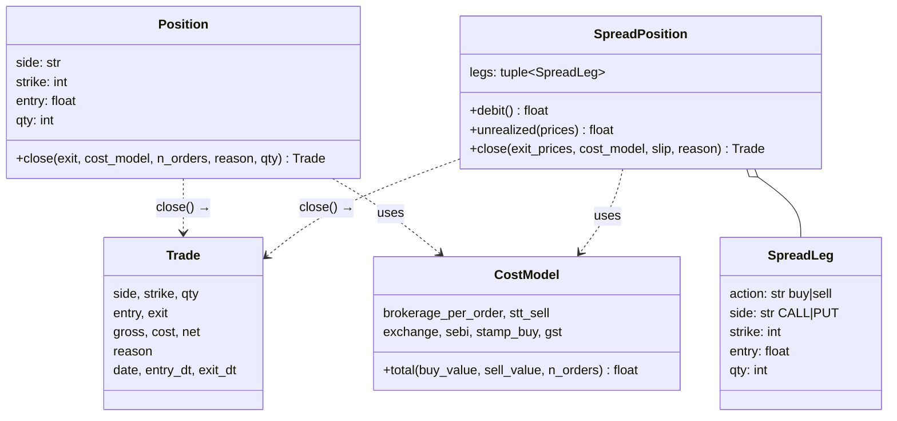
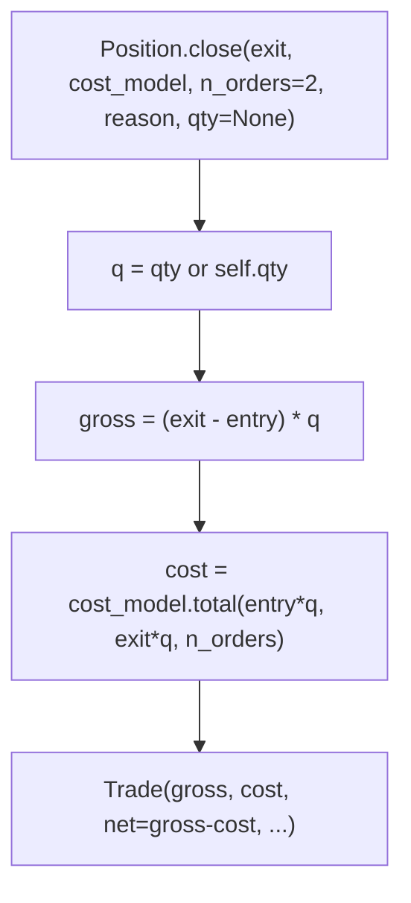
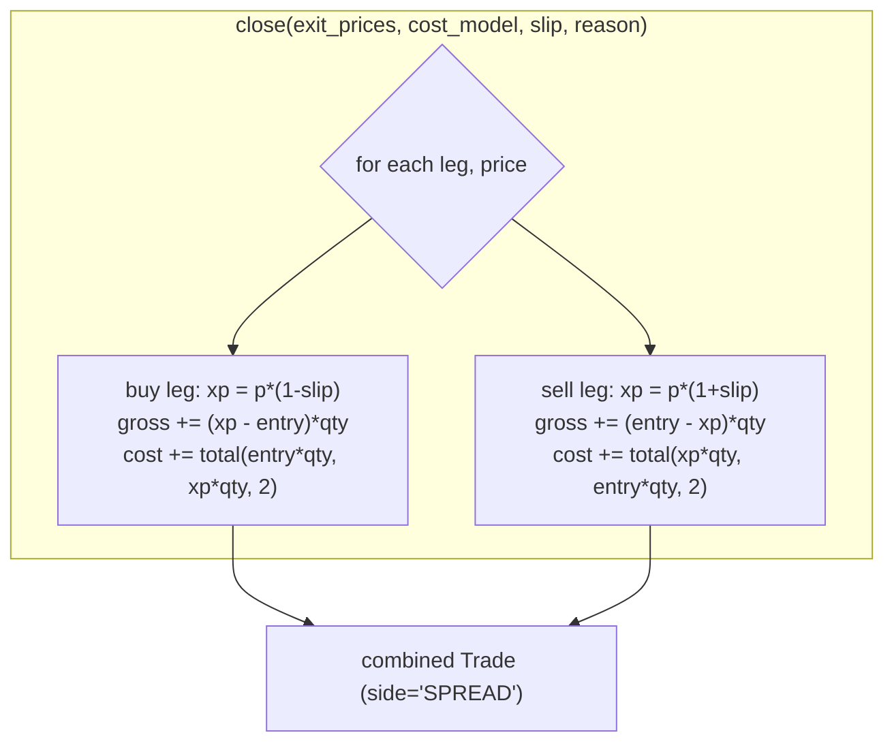
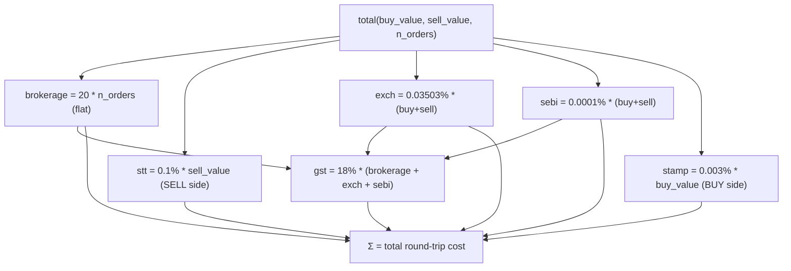
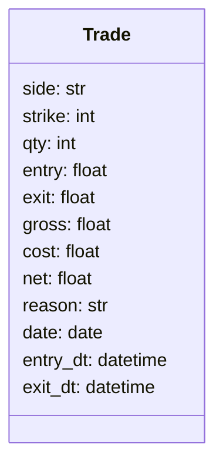
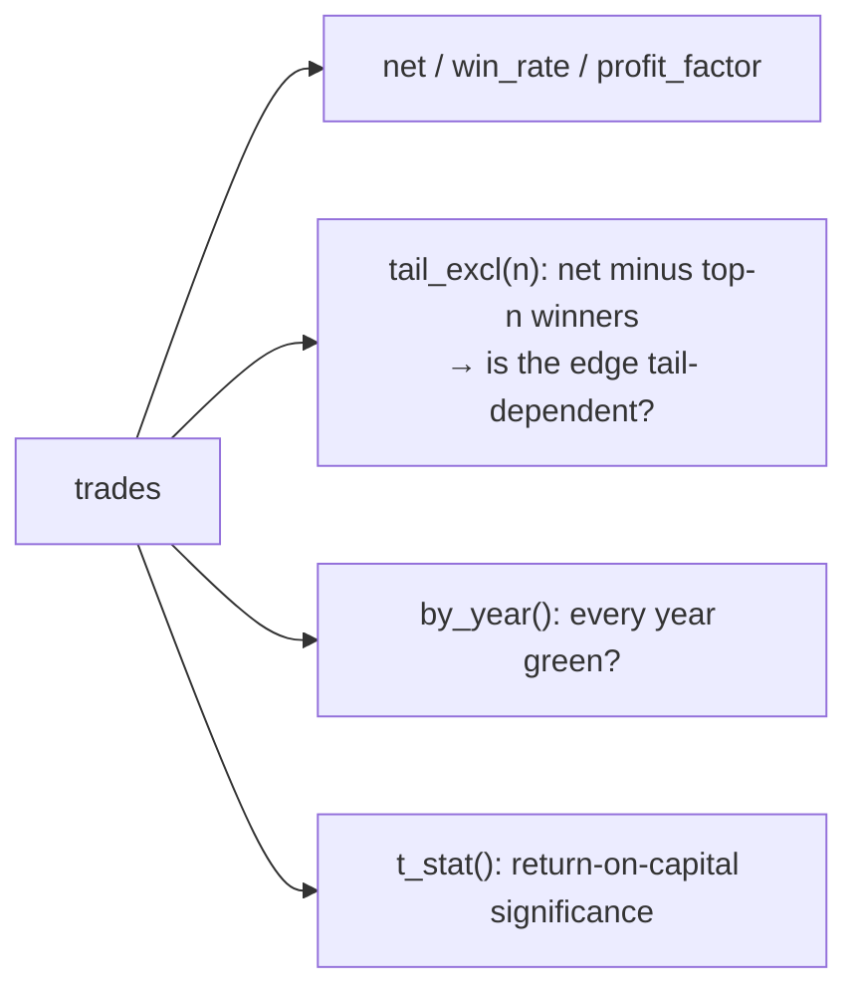

# LLD-05 — Positions, Costs & Metrics

> Modules: `engine/position/manager.py` (`Position`, `SpreadPosition`,
> `SpreadLeg`, `Trade`), `engine/execution/costs.py` (`CostModel`),
> `Result` (in `engine/backtest.py`, see [LLD-03](./lld-03-backtest-driver.md) §12).
> Parent: [High-Level Design](./high-level-design.md).

This is the accounting layer: how an open holding becomes a fully-costed `Trade`,
how India F&O transaction costs are computed, and how trades roll up into metrics.

## 1. Object model



`Trade` is a frozen, instrument-agnostic dataclass. The same type is reused by
the equity track (`side` = LONG/SHORT, `strike` = 0), so all `Result` metrics and
tear-sheet code work unchanged across options and equities.

## 2. `Position` — long-premium holding

A `Position` is a long-premium option holding. Buying either a call or a put
profits when *its own* premium rises, so P&L is the same formula for both:

```
gross = (exit - entry) * qty
```



**Partial closes**: pass a smaller `qty`; the caller (`Backtest._book`) books that
fraction and keeps a fresh `Position` for the remainder. This is what powers
scale-outs. `n_orders` defaults to 2 (one buy + one sell round trip).

## 3. `SpreadPosition` / `SpreadLeg` — multi-leg verticals

A `SpreadPosition` is a set of legs. Combined P&L is the sum of per-leg P&L, where
a BUY leg profits on a premium rise and a SELL leg on a fall:



- `debit()` — net premium paid to open (buy premium − sell premium received).
- `unrealized(prices)` — combined mark-to-market given current per-leg prices.
- `close(exit_prices, ...)` — closes all legs; a BUY leg sells-to-close DOWN, a
  SELL leg buys-to-close UP, both adverse. Each leg is costed independently
  (2 orders each). The resulting `Trade` reports a per-unit `entry` = `debit/qty`
  so capital-deployed metrics stay meaningful.

This gives the engine first-class credit/debit spread support, so premium-selling
structures are testable on the same trusted engine — subject to the driver's
naked-short guard (LLD-03 §4.2): each side's sold qty must be covered by bought
qty.

## 4. `CostModel` — India F&O card

The single place transaction costs are computed, ported verbatim from validated
production code and golden-tested:



| Charge | Rate | Applied to |
|---|---|---|
| Brokerage | ₹20 / order (flat) | per executed order |
| STT | 0.1% | sell-side premium |
| Exchange txn | 0.03503% | both sides |
| SEBI | 0.0001% | both sides |
| Stamp | 0.003% | buy side |
| GST | 18% | on (brokerage + exchange + SEBI) |

All rates are configurable (frozen dataclass fields), so a **stress preset** can
dial them up for a friction sweep. **Slippage is deliberately not here** — it is
applied adversely to the fill price inside the driver (LLD-03 §9), keeping "market
impact" and "statutory charges" as separate, independently-stressable knobs.

The cash-equity track has its own independent `EquityCostModel` (percentage
brokerage with a cap, different STT / exchange rates) — see
[LLD-06](./lld-06-equity-subsystem.md).

## 5. `Trade` — the closed unit



`net = gross - cost`. The `date`, `entry_dt`, and `exit_dt` timestamps are set by
the driver (via `dataclasses.replace`) after `close()` returns, since the
position object doesn't know the calendar context. `reason` carries the exit
cause (LLD-04 §7) for slicing results.

## 6. `Result` metrics recap

`Result` (specified in [LLD-03](./lld-03-backtest-driver.md) §12) aggregates a
list of `Trade`. The metrics chosen are the ones that catch a lying backtest:



- `tail_excl(n)` exposes edges that only exist because of a handful of monster
  winners.
- `by_year()` is the walk-forward eyeball — a real edge is green most years.
- `t_stat()` normalizes each trade by capital deployed (`entry * qty`), so a few
  large-notional trades can't masquerade as significance.

## 7. Design rationale

| Decision | Why |
|---|---|
| Single long-premium P&L formula | calls and puts both profit on own-premium rise |
| Partial close returns a fresh `Position` | clean scale-out without mutable state |
| Per-leg independent costing | spreads pay real per-order charges |
| Costs configurable + slippage separate | stress statutory vs. impact independently |
| One `Trade` type for options + equity | all metrics/tear-sheets reused unchanged |
| Naked-short refused at the driver | unbounded loss / margin / assignment unmodeled |
