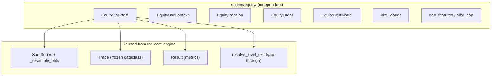
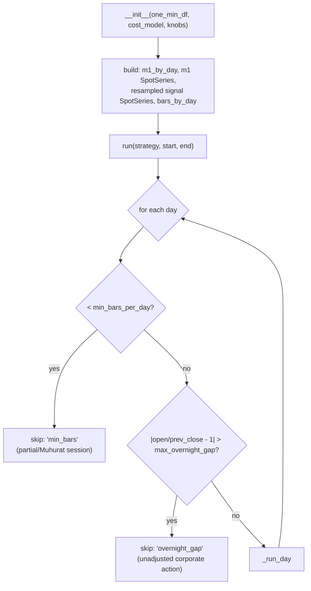
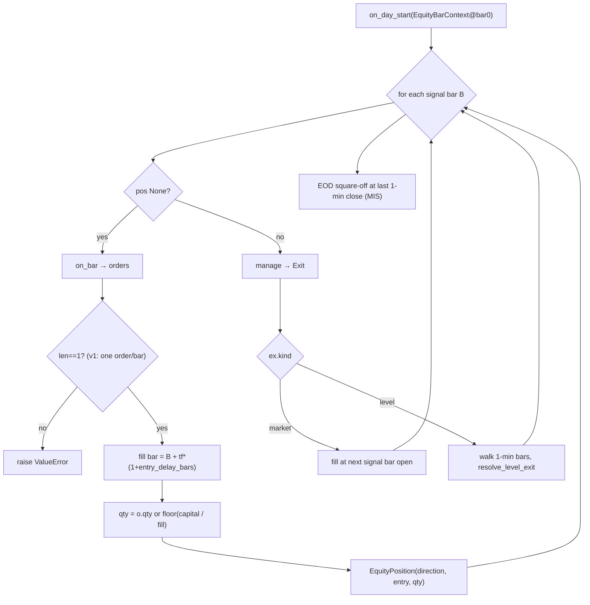
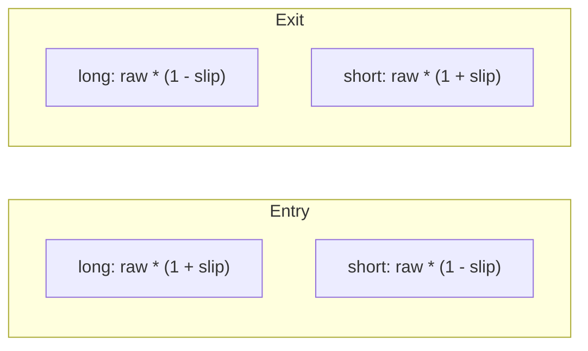
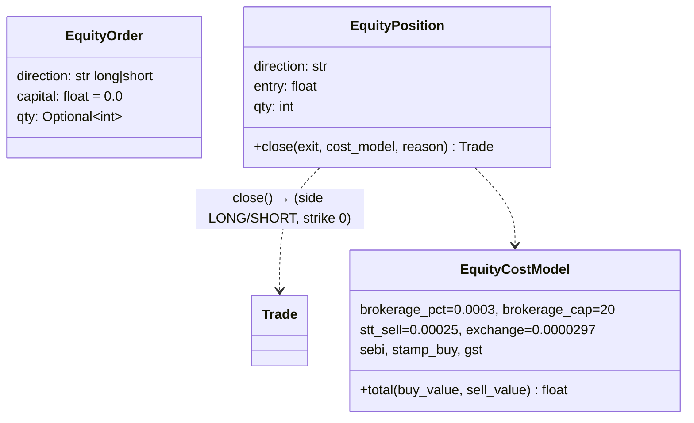
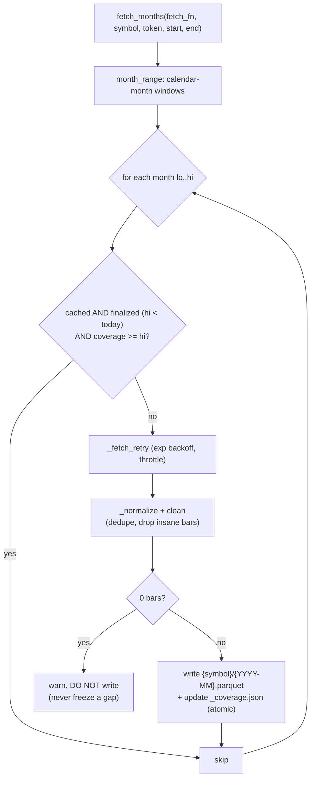
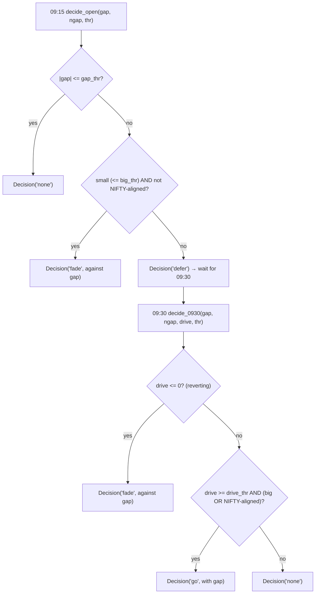

# LLD-06 — Equity Subsystem

> Modules: `engine/equity/backtest.py`, `context.py`, `position.py`, `model.py`,
> `costs.py`, `kite_loader.py`, `gap_features.py`, `nifty_gap.py`.
> Parent: [High-Level Design](./high-level-design.md).

A parallel cash-equity intraday track for NSE stocks (HDFCBANK, ADANIENT,
TATASTEEL). It mirrors the *shape* of the options driver but reads the stock's
own bars — no chain, no premium layer. It reuses only instrument-agnostic pieces.

## 1. What is shared vs. independent



The options `Backtest` is **never imported**. The equity context deliberately
duplicates ~6 one-line spot-forwarding methods rather than making the options
`BarContext`'s `chain` optional — zero shared mutable surface with the proven
options path (a deliberate zero-risk micro-decision from the 2026-07-03 spec).

## 2. `EquityBacktest` — the driver

Same `on_day_start → on_bar → fill next-open → manage → level/market/EOD` shape as
`engine/backtest.py._run_day`, but fills and exits read the stock's own 1-min and
resampled bars.



### 2.1 Day gates (data-quality guards)

Kite intraday history is **not back-adjusted**, so a bonus/split (HDFCBANK 1:1,
Aug 2025) makes prior-day levels garbage. Two gates protect against acting on bad
days, logged to `skipped_days` for visibility:

| Gate | Rule | Reason |
|---|---|---|
| `min_bars_per_day` | fewer than N of 375 1-min bars → skip | partial / Muhurat sessions |
| `max_overnight_gap` | `|open/prev_close - 1| > threshold` → skip | unadjusted corporate-action day |

Because the track is intraday-only, the only damage from a bad day is a wasted
signal day — never a corrupt overnight hold.

### 2.2 Per-day loop



Constraints in v1: **one order per bar** and **no partial exits**
(`ex.fraction != 1.0` raises). `entry_delay_bars` fills N extra strategy bars late
for latency stress.

## 3. Fills — direction-aware adverse slippage

Cash has a direction, not a side. Slippage is applied adversely to the fill price
by direction:



`_eff_slip` adds optional range-scaled friction: `slip += k * (high-low)/mid` at
the fill bar (`slippage_range_k`, default 0 = flat historical). Base slip default
is **0.0005** (~HDFCBANK cash spread) — NOT the options 0.25%.

## 4. `EquityOrder` / `EquityPosition` / `EquityCostModel`



- **Sizing** defaults to fixed **capital** per trade (`qty = floor(capital / fill)`)
  so capital-at-risk stays constant as the stock's price level drifts over a
  multi-year backtest. A fixed `qty` overrides it (rupee risk then drifts — the
  caller's choice).
- **`EquityCostModel`** is the Zerodha cash-MIS card: percentage brokerage with a
  ₹20 cap per order, sell-side-only STT at 0.025%, NSE cash exchange rate. It
  shares only the `.total(...)` shape with the F&O `CostModel`, no logic.
- **`EquityPosition.close`** books long (buy entry, sell exit) or short (sell
  entry, buy exit) into the shared `Trade`.

## 5. Data ingestion — `kite_loader`

The only component that touches the Kite network API. Everything downstream reads
its cached parquet output (deterministic, offline-reproducible). The backtest
never calls Kite.



Design points:

- **Chunked per calendar month** (≤31 days) — Kite caps minute candles at ~60
  days/request and rate-limits ~3 req/s. Throttle + exponential-backoff retry.
- **Resumable** via a `_coverage.json` manifest recording the end-date each month
  was fetched *through*. A finalized month with complete coverage is skipped; the
  **current month is always refetched** (it may have gained days). A month first
  cached mid-month (partial) is re-fetched once it ends, so no permanent hole.
- **Never persist an empty fetch** — an empty result is a transient API failure;
  writing it would cement a gap. Leave it retryable.
- **`clean`** is the integrity pass: dedupe/sort by `DateTime`, drop non-positive
  prices and bars where `High < max(O,C)` or `Low > min(O,C)`.
- **`load_cached`** concatenates + cleans all cached months into the 1-min frame
  the `EquityBacktest` (and `SpotSeries`) consume.
- Credentials come from the tradealgo `.env`; `kiteconnect`/`dotenv` are imported
  lazily inside `make_kite`, so tests and the backtest need neither installed.

## 6. Gap router — `gap_features` + `nifty_gap`

Pure gap-classification logic (no pandas, no I/O), shared by
`strategies/gap_router_equity.py`, `analysis/hdfc_gapandgo.py`, and the unit tests
so the classification can never drift.



- **Two checkpoints**: `decide_open` (09:15) fades small unconfirmed gaps
  immediately and defers the rest; `decide_0930` resolves deferred gaps —
  reverting → fade, driving hard and (big or NIFTY-aligned) → go, else stand
  aside.
- **Helpers**: `compute_gap`, `signed_drive` (drive measured in the gap's
  direction), `aligned` (NIFTY gapped the same way and enough), `fade_side` /
  `go_side`.
- **`NiftyGapProvider`** (`nifty_gap.py`) isolates the one external input — the
  per-date NIFTY gap from `data_index/NIFTY/gap.parquet`. Missing dates return
  `None`, which the router treats as "NIFTY not aligned."

## 7. `EquityKnobs`

```python
EquityKnobs(slippage_pct=0.0005, timeframe="5min",
            min_bars_per_day=300, max_overnight_gap=0.15,
            slippage_range_k=0.0, entry_delay_bars=0)
```

| Knob | Meaning |
|---|---|
| `slippage_pct` | base adverse slip (~cash spread, not options 0.25%) |
| `timeframe` | signal-bar size / fill offset |
| `min_bars_per_day` | skip partial/Muhurat sessions |
| `max_overnight_gap` | skip unadjusted corporate-action days |
| `slippage_range_k` | range-scaled friction stress (0 = off) |
| `entry_delay_bars` | latency stress: fill N extra bars late |

## 8. Design rationale

| Decision | Why |
|---|---|
| Never import the options driver | zero risk to the proven path; parallel evolution |
| Duplicate ~6 context methods | no optional `chain`, no shared mutable surface |
| One `SpotSeries` = signal + fill feed | cash has no derivative layer |
| Capital sizing by default | constant risk across multi-year price drift |
| Independent `EquityCostModel` | cash MIS charges differ entirely from F&O |
| Cache-then-backtest split | deterministic, offline-reproducible; API isolated |
| Never write an empty fetch | a transient failure must not freeze a data gap |
| Pure gap logic in one module | classification can't drift across callers |
