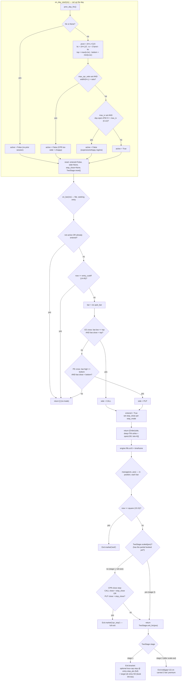

# CPR Breakout — Strategy Explained

> Code: `strategies/cpr_breakout.py` (`CPRBreakout`).
> Engine docs: [design overview](../designs/high-level-design.md),
> [strategy API](../designs/lld-02-strategy-api.md),
> [exit mechanics](../designs/lld-04-exit-mechanics.md).

This is the validated winner of the strategy set. It buys a **deep in-the-money
NIFTY option** when price breaks out of yesterday's "value zone", then manages the
trade with a partial profit-book and a trailing stop. This page explains it in
plain terms, with a full worked example.

## 1. The idea in one paragraph

Every trading day has a small price zone where most of yesterday's action
happened — the **CPR** (Central Pivot Range). If today's price pushes cleanly
*above* that zone, the market is leaning up; if it breaks cleanly *below*, it's
leaning down. This strategy waits for that clean break, then buys a deep-ITM
option in the breakout direction (a CALL for an up-break, a PUT for a
down-break). Deep-ITM because it behaves almost like the index itself (little
time-decay risk), so a directional move pays off without fighting option theta.

## 2. What is CPR?

CPR is three price levels computed from **yesterday's** High, Low, and Close:

```
Pivot  = (High + Low + Close) / 3
BC     = (High + Low) / 2
TC     = 2 * Pivot - BC

top    = max(TC, BC)      ← the CPR band is the zone [bottom, top]
bottom = min(TC, BC)
```

Think of `[bottom, top]` as a fence around yesterday's fair value. A **narrow**
fence means yesterday was trendy/decisive; a **wide** fence means it was
choppy/rangebound. The strategy only trades days where the fence is meaningful
(see the filters in §6).

## 3. Plain-English rules

- **Setup (once, at day start):** draw today's CPR fence from yesterday's H/L/C.
  Decide if today is even worth trading (IV and CPR-width filters).
- **Entry (each 5-min candle, until 14:45):** if a candle *pierces and closes
  beyond* the top of the fence → buy a deep-ITM **CALL**. If it pierces and
  closes below the bottom → buy a deep-ITM **PUT**. One trade per day.
- **Exit:** book most of the position at a fixed profit, trail the rest, and bail
  out fully if price falls back through the fence or the day ends.

The "pierce **and** close beyond" rule is important: the candle must physically
trade through the edge (its low touches the top for a CALL), not just gap open
past it. This throws away fake gap-driven breaks.

## 4. Parameters

Defaults are the walk-forward-validated deployable config.

| Parameter | Default | Meaning |
|---|---|---|
| `book_prem` | 50 | premium points of profit at which to scale out |
| `book_lots` | 4 (of 6) | how many of the 6 lots to book at target |
| `trail_prem` | 12 | trailing distance (premium points) for the carried lots |
| `stop_mode` | `"far"` | CPR-close stop: `far` = opposite edge, `broken` = the edge just crossed, `none` = off |
| `stop_prem` | `None` | optional hard premium loss-cap (off by default) |
| `max_cpr_ratio` | `None` | skip days where the fence is too wide vs. yesterday's range (off by default) |
| `max_iv` | 0.12 | skip days whose day-open ATM implied volatility is above this |
| `entry_cutoff` | 14:45 | no new entries after this time |
| `square` | 15:15 | force-close everything at this time |

Fixed in code: `LOTS = 6`, `ITM_DEPTH = 150` (deep-ITM strike offset).

## 5. Full flow



## 6. Why the two filters exist

- **IV filter (`max_iv = 0.12`):** high implied volatility = expensive premium and
  whippy price. Buying options in that regime means paying up and getting stopped
  out on noise. Across every strategy in this repo, cheap premium (low IV) is the
  single binding edge filter for option *buying*, so days with day-open ATM IV
  above 0.12 are skipped entirely.
- **CPR-width filter (`max_cpr_ratio`, off by default):** a very wide CPR relative
  to yesterday's range signals a choppy, rangebound day where breakouts fail. When
  enabled, it skips those days.

Both filters simply flip `active = False`, and an inactive day never emits an
order.

## 7. Worked example — an up-breakout day

### Step 0 — yesterday's numbers

Suppose NIFTY closed yesterday with:

```
High = 22,200   Low = 21,800   Close = 22,150   (a strong up-day, close near the high)
```

### Step 1 — `on_day_start` builds today's fence

```
Pivot  = (22,200 + 21,800 + 22,150) / 3 = 22,050
BC     = (22,200 + 21,800) / 2          = 22,000
TC     = 2 * 22,050 - 22,000            = 22,100

top    = max(22,100, 22,000) = 22,100
bottom = min(22,100, 22,000) = 22,000
```

Today's CPR fence is **[22,000 → 22,100]** (100 points wide).

Filters: assume day-open ATM IV = 0.10 (≤ 0.12 ✓) and `max_cpr_ratio` is off →
`active = True`. Reset state, ready to look for an entry.

### Step 2 — `on_bar` waits for a clean break

Today NIFTY opens at 22,050 (inside the fence — no signal yet). A few 5-min
candles pass with no clean break. Then at, say, 10:15 a candle prints:

```
low = 22,080   close = 22,120
```

Check the CALL cross condition:
- `bar.low (22,080) <= top (22,100)`  ✓ — the candle traded *through* the top
- `bar.close (22,120) > top (22,100)` ✓ — and closed above it

→ **CALL breakout.** The strategy sets `entered = True` and picks the strike:

```
base   = (int(22,120) // 50) * 50 = 22,100
strike = base - ITM_DEPTH = 22,100 - 150 = 21,950   (deep-ITM CALL, ~delta 0.8)
Order(side=CALL, strike=21,950, lots=6)
```

With `stop_mode = "far"`, the CPR-close stop is set to the **opposite edge**:
`stop_close = bottom = 22,000`.

### Step 3 — the engine fills the order

The signal is on the 10:15 bar; the engine fills at **10:20** (next bar's option
open) — never on the signal bar itself. Say the 21,950 CE opens at **₹200**
premium. With 6 lots at a 75 lot size, that's `6 × 75 = 450` units. Slippage
makes the real fill slightly worse (e.g. ₹200.50 at 0.25%).

### Step 4 — `manage` runs every bar until the trade closes

The position is handled by a two-stage plan:

**Stage 1 (full size, 6 lots):**
- If any later candle *closes* back below 22,000 (the CPR-close stop), exit all 6
  lots with reason `cpr_stop`. The up-thesis is broken.
- Otherwise a resting **target** sits at entry + 50 = **₹250** premium.

Say the premium climbs and a bar's option high reaches ₹252. The target at ₹250
fills. The strategy **books 4 of 6 lots**:

```
profit on booked tranche ≈ (250 - 200) × (4 × 75) = 50 × 300 = ₹15,000  (gross, before costs)
```

**Stage 2 (carried 2 lots):** now the plan switches to a **trailing stop** 12
premium points below the running peak.
- The premium keeps rising; peak reaches ₹270 → trail stop = 270 − 12 = ₹258.
- The premium then dips to ₹258 → the last 2 lots exit:

```
profit on trailed tranche ≈ (258 - 200) × (2 × 75) = 58 × 150 = ₹8,700  (gross, before costs)
```

**Day's result (illustrative):** ≈ ₹15,000 + ₹8,700 = **₹23,700 gross**, minus
transaction costs and slippage (the engine applies the full India F&O cost card).

If instead price had reversed and closed below 22,000 before the target hit, the
whole position would have exited at `cpr_stop` for a loss. And any position still
open at **15:15** is force-closed (`eod`).

> These rupee figures are a made-up illustration to show the mechanics. Real
> backtested performance is in §8.

## 8. Backtested performance (from the code docstring)

At 6 lots, 5-min, 0.25% slippage, over ~6.2 years:

- Net **+₹745k**, Profit Factor **1.43**, Sharpe **1.08**, Sortino **2.77**,
  Calmar **0.98**, max drawdown **−₹123k**, **6/7 years green**.
- Walk-forward validated (the IV ≤ 0.12 threshold was chosen on prior years and
  held out-of-sample), fill-audited, and volume-floored.

This is the Stage-4 live-pilot candidate. See `analysis/cpr_*.py` for the sweeps
behind these numbers.

## 9. How it maps to the engine

| Strategy piece | Engine mechanism | Doc |
|---|---|---|
| `prev_day_hlc()`, `spot_bar` | look-ahead-safe `BarContext` | [LLD-02](../designs/lld-02-strategy-api.md) |
| `Order(side, strike, lots=6)` | fill at `B + timeframe`, sized via date-keyed lot | [LLD-03](../designs/lld-03-backtest-driver.md) |
| target + scale-out + trail | `TwoStage` → `Bracket` then `Exit.trail` | [LLD-04](../designs/lld-04-exit-mechanics.md) |
| `Exit.market('cpr_stop' / 'eod')` | next-open discretionary exit | [LLD-04](../designs/lld-04-exit-mechanics.md) |
| profit/cost accounting | `Position.close` → `Trade` via `CostModel` | [LLD-05](../designs/lld-05-position-costs-metrics.md) |
